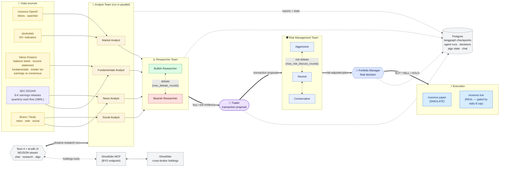

# ai-trader

Self-hosted trading copilot. Chat with an AI that has tools for moomoo market data/trading, Ghostfolio portfolio reconciliation, TradingAgents research, and paper-only algo workflows.

**Current end-to-end flow:**

- Log in (single password), see your moomoo watchlist in the sidebar — or in the
  navigation drawer on a phone, where the same rail (watchlist + past
  conversations) moves behind the ☰ button.
- Ask `show NVDA daily` → real candlestick chart inline.
- Ask `what's on my watchlist?` → list pulled from your real moomoo account.
- Ask `add US.AAPL to my watchlist` / `remove US.NVDA` → mutates moomoo's watchlist, and the sidebar reloads when the reply finishes. A rejected add (for example a code without its market prefix) shows the reason above the list and leaves the list in place.
- Ask `any news on NVDA?` → Tavily-powered news cards.
- Ask `show me my portfolio` → real positions + cash from your paper or live moomoo account; Ghostfolio MCP can add tracker/reconciliation context when configured.
- Ask for a full ticker analysis → TradingAgents runs analysts, bull/bear debate, risk review, and a portfolio-manager verdict.
- Ask `should I buy NVDA?` or `which of these should I add to?` → before the assistant recommends buying or adding to a stock, it gets a debate verdict for that ticker without being asked (see [Debate before a buy](#debate-before-a-buy)).
- Ask `notify me when NVDA hits 150` or `remind me to check NVDA earnings on Friday 9am` → an email and a push notification when it fires (see [Notifications & reminders](#notifications--reminders)).
- Manage paper algo strategies from `/algo`; scheduler order placement is paper-only. **go live (paper)** stays disabled until the strategy is saved and its latest backtest clears the blocking checks, and the reason is printed under the button. Saving a change to anything but the name discards the backtest on screen, because it was run on the old code or settings; run a new one before going live. The gate is in the page only: the api does not check backtests. A failed go-live, stop, or kill-switch request shows its error next to the control. Passing checks fold into one "all N checks passed" line. Below 1024px the strategy assistant opens from the **chat** button as a side panel (Esc closes it); order ids sit under **technical details** in the signals table.

## Prereqs

- Docker Desktop (or compose v2)
- moomoo OpenD installed on the host machine and **logged in**, listening on `127.0.0.1:11111`
- An API key for at least one online model provider: Anthropic, OpenAI, Google, DeepSeek, or OpenRouter. You add it in the app under Settings, not in `.env`.
- (Optional but recommended) Tavily API key for news/web search — without it, search tools surface a clean error message and the rest still works

## First run

```sh
cp .env.example .env
# Edit .env:
#   APP_PASSWORD       — what you type to log in (anything)
#   SESSION_SECRET     — at least 32 random bytes; changing it signs everyone out
#   INTERNAL_BEARER    — used between Nuxt and FastAPI; generate with `openssl rand -base64 32`
#   ENCRYPTION_KEY     — encrypts stored provider keys; generate with `openssl rand -base64 32`
#   The web service refuses to start while INTERNAL_BEARER or ENCRYPTION_KEY is
#   the `change-me…` example value or shorter than 32 characters.
#   TAVILY_API_KEY     — tvly-… key for news/web search (optional)
#   SEC_USER_AGENT     — "<app> <email>" sent to SEC EDGAR for earnings releases (has a default)
#   POSTGRES_PORT      — host port for postgres (default 5432; override if 5432 is taken)
#   RESEND_*, VAPID_*  — email and push for alerts/reminders (optional; see Notifications & reminders)

docker compose up -d --build
open http://localhost:3000
```

Sign in with `APP_PASSWORD`, open **Settings**, add a model provider, and pick a chat model and a quick model (see [Model providers](#model-providers)). Then type `Show me NVDA daily` in the chat box. The empty chat also offers four opening prompts drawn from your watchlist, holdings, and recently triggered alerts; they redraw on every new chat and fall back to a static set when nothing is configured yet.

If the chat says "No model provider is configured", nothing has been saved in Settings yet. The link under the chat box goes there.

A sign-in lasts 30 days, then the app asks for the password again. After 10 wrong passwords from one address in 15 minutes, login answers 429 until the window passes. The count lives in memory and resets when the web container restarts. Behind a reverse proxy every visitor shares the proxy's address, so the limit applies to everyone at once. The session cookie is marked `Secure` when the request arrived over https (directly or with `X-Forwarded-Proto: https`); set `SESSION_COOKIE_SECURE=true` or `false` in `.env` to force it.

## Model providers

Settings (`/settings`, also reachable from the `model · …` badge in the header on wide screens, or the model line at the foot of the menu drawer on phones) holds the LLM configuration. Nothing about models lives in `.env` except `ENCRYPTION_KEY`.

- **Providers.** Add as many as you like from the online providers: Anthropic, OpenAI, Google, DeepSeek, and OpenRouter. Local model servers such as Ollama are not supported. Every provider needs an API key. Each uses its public endpoint unless you switch on **Override base URL**, for example to route through a company proxy. An override must be an `https://` URL on a public host: `localhost`, private, loopback and link-local addresses, bare container names such as `api`, and `.local` or `.internal` hosts are rejected. For models none of these host directly, use OpenRouter.
- **Keys.** A key is encrypted with AES-256-GCM under `ENCRYPTION_KEY` before it is stored. The page shows only its last four characters. Editing a provider with the key field blank keeps the stored key, unless you change the base URL or switch the override off: then the key field is required, so a stored key is never sent to a host it was not entered for. Changing or losing `ENCRYPTION_KEY` makes stored keys unreadable, so re-enter them if you rotate it. Until you do, chat, **test connection** and research runs report that the stored key can't be decrypted and point you to Settings.
- **Test connection.** Lists the provider's models. It also sends a short request to each model the Models section currently points at this provider, saved or not, so a wrong model id for either the chat or the quick role shows up here rather than in chat. Switching a role to another provider clears its model unless that provider lists the same id. Editing a provider clears its earlier test result and model list.
- **Models.** Two roles. The **chat model** runs chat, risk reports, strategy authoring, and the research debate's deep-thinking agents. The **quick model** runs news angles and the debate's fast analyst passes. Each role picks a provider and a model id. The model field suggests the provider's model list and accepts any id you type.
- **Removing a provider.** Blocked while either role uses it. Point the role at another provider and save first.
- **Upgrading from `LLM_MODEL` env vars.** On first start with an empty provider table, the web service imports `LLM_MODEL`, `LLM_MODEL_QUICK`, and the matching `*_API_KEY` from its environment into Settings and logs `[llm] imported …`. If `LLM_MODEL` names a provider with no key in the environment, only the keys are imported and the log says to pick the chat and quick models in Settings. It runs once. After that the env vars are ignored and can be deleted.
- **Cost.** A chat reply that fails partway is still charged for the steps that finished. `/usage` prices calls for models in the built-in price table. Other models show as unpriced, and every total and source says how many unpriced calls it leaves out of its cost ("3 calls · 1 unpriced"). The totals and the by-source bars include finished agents debates (source `agents-debate`, at the cost the api computed for the run, resumes included); the recent-calls table lists only the web app's own calls, and each debate's cost is in the research page's run history. **today** starts at midnight in the timezone set under Settings → Notifications. Costs show to the cent; a cost under a cent shows two significant digits (e.g. `$0.0042`) so it doesn't read as free.
- **Data quotas.** When `ALPHA_VANTAGE_API_KEY` is set, `/usage` also shows how many of today's 25 Alpha Vantage requests are left (UTC day). See [Alpha Vantage budget](#reading-earnings-below-the-headline).

Behind a reverse proxy, long chat and research streams can sit quiet between tokens. nginx drops a proxied response after 60 s of silence by default. Raising `proxy_read_timeout` (for example to `600s`) on the location that serves the web app is optional but avoids cut-off replies.

Settings has four tabs: **models** (the providers and models above), **notifications**, **memory**, and **prompts**. The open tab is kept in the URL (`/settings?tab=prompts`).

## Chat memory

The assistant keeps a short list of facts about you that every chat thread shares, so a new conversation does not re-raise what you have already settled. Settings → **memory** shows the list.

- **What it is for.** Standing preferences, intentional decisions, risks you already accept, constraints and goals. Example: "The owner's holdings are mostly USD against a MYR base currency; this is intentional and needs no warning."
- **How the assistant uses it.** Every chat message gets the full list. A risk recorded as intentional or already known is not flagged again and gets no caveat, even where the chat prompt says to flag it. The assistant raises it again only if you ask, or if the live data shows it has materially changed since. The fact still counts in the numbers: position sizing, currency arithmetic and the trade-safety rules are unchanged.
- **Learned from chat.** After each reply finishes, the quick model reads your message and decides whether it states something lasting. It saves only what you said. The assistant's own words and tool output are never a source. It can add a memory or rewrite one that your message corrects; it never deletes one. Questions, one-off requests, prices and position sizes are not saved. A reply you stop, and a slash command, save nothing.
- **Added by you.** **add memory** saves a fact in your own words. The pencil edits one and the bin deletes it after a confirmation. Each row says whether it was **added by you** or **learned from chat**. Editing a learned memory makes it yours.
- **When changes apply.** The next chat message uses the saved list. A memory learned from a message is available from the message after it.
- **Limits.** At most 30 memories of at most 240 characters each. When the list is full, **add memory** is disabled and the assistant only rewrites existing memories. Text identical to a saved memory is rejected.
- **Cost and failures.** Each chat message makes one extra quick-model call, listed on `/usage` under the source `chat-memory`. It runs after the reply and never delays it. If the call fails, nothing is saved from that message and the server logs a warning. If the list cannot be read within 2 s, the reply goes ahead without it.
- **The prompt behind it.** Settings → prompts → **Chat memory** is the instruction that decides what is worth saving.

## Editable prompts

Settings → **prompts** lists the instructions each model gets, grouped as Chat, Research, News, Algo and Agents debate. Click a row to open its text. A **modified** badge marks a prompt you have edited.

- **What you can edit.** Chat: the chat system prompt, the moomoo rules, the chat titles prompt and the chat memory prompt. Research: the risk report. News: the search angles. Algo: the strategy assistant. Agents debate: the 13 TradingAgents node prompts (the four analysts, bull and bear researchers, research manager, trader system and request, the three risk analysts, risk manager), the confidence judge and the owner mandate (see [Deciding for the owner](#deciding-for-the-owner)).
- **When edits apply.** The next chat message, report or debate run uses the saved text. A run already in progress keeps the text it started with.
- **Defaults.** A prompt you have not edited follows the built-in default, so it picks up future changes to it. A **modified** prompt keeps your text and does not pick them up: after an upgrade that changes a default (for example the chat prompt's reply style and debate-before-a-buy rules), reset the prompt or copy the new sections from the default shown in the editor. Saving text identical to the default clears the override. **reset to default** (shown only on a modified prompt) asks for confirmation, then deletes your text.
- **What the chat prompt does not include.** The server appends a runtime block to the chat prompt on every turn, after your text: the current date and time in the timezone set under Settings → Notifications, the Ghostfolio status, the latest completed research run for each stock you mention that you have researched before (by ticker in any case, `$TICKER`, or company name; a ticker that is also an everyday word, such as NOW, counts only in capitals or as `$now`), your saved memories with the rule for using them (see [Chat memory](#chat-memory)), and the slash-command directive. That block is not editable.
- **Placeholders (agents debate only).** Debate prompts are Python format templates. The editor shows the `{placeholders}` the default uses as chips; your text may use any of them and no others. Any other literal brace must be doubled (`{{` or `}}`). Unknown placeholders and stray braces are rejected when you save, with the reason shown under the text.
- **Contract lines.** The risk manager's output must contain `FINAL TRANSACTION PROPOSAL`, the confidence judge's must ask for a `CONFIDENCE:` line and the owner mandate must ask for an `OWNER VERDICT` line, because the debate parses them. Removing that wording shows a warning but does not block the save; the run may then fail to read a decision, a confidence score or the owner verdict.
- **Limits.** A prompt cannot be empty or longer than 50,000 characters.
- **If the api is down.** The debate prompts' defaults come from the api service. While it is unreachable, the Agents debate group shows an error with a retry and its rows cannot be opened; the other groups still work. If a debate run cannot read the overrides, it logs a warning and uses the defaults.

## Notifications & reminders

Price alerts and reminders are delivered by **email** (Resend) and **Web Push** to every subscribed device. Finished research runs and chat replies are **push only**: they never send email. While an app tab is open, a triggered price alert also shows a browser notification (the tab polls for alerts fired in the last 10 minutes).

- **Price alerts.** Arm one under the holdings tab of `/portfolio` or in chat (`notify me when NVDA hits 150`). The server checks armed alerts every minute and fires each one once. An alert fires on the price level, so one whose condition already holds is refused with the current price: with NVDA at 180, "notify me when NVDA hits 150" becomes a below-150 alert, and the chat picks the direction from that reply. A day-move alert the session has already passed, or one of 100% or more, is refused too. Symbols moomoo has no quote for (SGX, crypto, futures, US share classes such as BRK-B) are checked against Yahoo's delayed quote; a symbol neither source can price is refused, since its alert could never fire. The panel lists every armed alert and the 10 most recent fired or cancelled ones. Cancelling an alert that fired in the meantime says when and at what price it fired, here and in chat.
  - The alert email shows the name and symbol, the last price with the day change, and which condition fired and when you set the alert.
  - It has a price chart of today's session in 5-minute bars (or the last 3 months of daily closes when there is no session data). The chart marks the alert threshold (amber dashed line) and the previous close (grey dotted line). A line is left out when its level is too far from the price to fit without flattening the chart.
  - Below the chart: open, previous close, day range, 52-week range, volume and the distance from the threshold.
  - When you hold the stock in your moomoo live account, a **Your position** block shows quantity, average cost, market value and unrealized P&L.
  - Your note is included, and the **Open research** and **Manage alerts** buttons appear when `APP_PUBLIC_URL` is set.
  - This data is fetched when the alert fires, with an 8-second limit per piece. A piece that fails or times out is left out of the email, and the alert still fires.
  - The push notification reads like `343.46 (+1.20% today) · crossed above 340.00`.
- **Reminders.** Schedule one under the holdings tab of `/portfolio` (when, message, optional symbol) or in chat (`remind me to check NVDA earnings on Friday 9am`). Times are entered and shown in the timezone set in Settings → **notifications**, not the device's. A due time can be at most a year ahead. **cancel** asks for confirmation; a reminder that already fired cannot be cancelled.
- **Research runs** (push only). When an agents debate finishes, fails or is cancelled you get its rating and confidence, with a link to the run. This covers runs started from the research page and background runs the chat starts with `research_start`. A debate the chat runs inline (`agents_debate`) does not push on its own; the chat reply that reports it does. An open app tab also shows a browser notification for a finished run; it opens the run on its symbol page and replaces the push for the same run rather than adding a second one.
- **Chat replies** (push only). When a copilot reply finishes and you are not looking at that chat, you get a push with the chat title and the start of the reply. Tapping it opens that chat. "Not looking" means the tab is in the background, the window is not focused, the app is closed, or another chat is open. A reply you stopped does not push. A reply that failed pushes "Reply failed" with the reason. Each open tab tells the server whether it shows the chat, and repeats it every 30 seconds while it does; a tab not heard from for 60 seconds counts as gone.

**Settings → notifications**

- **Recipient email.** Blank (the default) means nothing is emailed. **send test email** sends one email to the saved address straight away and shows the result.
- **Timezone** for reminders, and on/off switches for each category (price alerts, reminders, research runs, chat replies). Each switch is labelled **email + push** or **push only**. A switched-off category is still recorded but not sent.
- **Push devices.** **enable push on this device** asks the browser for permission (only when you click it) and subscribes that browser. After rotating `VAPID_*` keys, click it again on each device: a subscription made with the old key is replaced rather than reused. Every subscribed device is listed with when it last received something; the bin icon removes it after a confirmation. **send test push** pushes to all of them. A device the push service reports as gone is removed automatically.
- **iPhone / iPad.** Push works only from the Home Screen app: in Safari tap Share → **Add to Home Screen**, open ai·trader from the Home Screen, then enable push there. The page shows this hint when it is opened in the browser on iOS.
- **Desktop Chrome on a Mac.** The browser can accept a push and macOS can still hide it. If **send test push** reports the device as sent but nothing appears, open System Settings → Notifications and turn on **Allow notifications** for both **Google Chrome** and **Google Chrome Helper (Alerts)**. Check that Focus / Do Not Disturb is off. Chrome must be running (a window can be closed) to receive push. Each browser has to be enabled separately: it should appear in the device list.
- **Scheduler.** When each check (price alerts, reminders, email/push sender) last ran. A check that has not run for 3 minutes shows **not running** in red, here and on the alerts and reminders panels.

**How sending works.** Three Nitro scheduled tasks run every minute inside the web container: `alerts:evaluate`, `reminders:dispatch` and `notify:send`. A triggered alert, a due reminder or a finished run writes one row to the `notifications` outbox in the same transaction that changes its status, keyed so the same event can never be queued twice. The producing task then starts the sender at once, so a trigger goes out within seconds; `notify:send` also sweeps the outbox every minute. It delivers each row by email and push and records each channel as `sent`, `failed` or `skipped`. A channel is **skipped**, not failed, when the category is push only (email shows `push-only notification`), its category is off, there is no recipient, its keys are unset, or no device is subscribed. A temporary failure, including an unexpected error in the sender itself, is retried with backoff (1, 4, 16, 64 minutes) up to 5 attempts, and a channel that already went out is not sent again; a rejected address or key fails at once, and so does a push every device's push service refused (a 4xx other than 408 or 429, such as a VAPID key mismatch after rotating keys). Emails carry a Resend idempotency key, so a retry after a crash does not send twice. The alert chart is rendered to a PNG when the alert fires (by `@resvg/resvg-js`) and stored with the outbox row. It is attached as an inline image, so every retry sends the same image. The web, api and postgres containers restart on their own (`restart: unless-stopped`); after a restart the tasks pick up where they left off.

**Setup** (`.env`, then `docker compose up -d --build web`):

| Variable | What it does |
|---|---|
| `RESEND_API_KEY` | Resend API key. Unset: email is skipped. |
| `RESEND_DOMAIN` | A domain verified in Resend. Mail comes from `ai-trader <alerts@RESEND_DOMAIN>`. |
| `APP_PUBLIC_URL` | Public base URL for links in emails (`https://trader.example.com`). Unset: emails have no links. |
| `VAPID_PUBLIC_KEY`, `VAPID_PRIVATE_KEY` | Web Push keys, from `npx web-push generate-vapid-keys`. Changing them unsubscribes every device. Unset: push is skipped. |
| `VAPID_SUBJECT` | Contact for the push services, e.g. `mailto:you@example.com`. |
| `PRICE_ALERTS_DISABLED` | `1` stops the price-alert check; reminders and sending keep running. (`PRICE_ALERTS_INTERVAL_MS` is gone: every check runs once a minute.) |

Push needs the app served over HTTPS (or `localhost`). `/sw.js`, `/manifest.webmanifest` and the app icons are served without a login so the browser and the Home Screen can fetch them.

## Stop / clean up

```sh
docker compose down       # keep DB volume
docker compose down -v    # also wipe DB volume (resets users / chat history)
```

## Repo layout

```
apps/
  web/                 # Nuxt 4 + Nuxt UI v4 + AI SDK chat orchestration
    app/               # Nuxt 4 layout: components, pages, layouts
    server/            # Nitro routes, middleware, chat prompt + tools
    db/                # Drizzle schema + migrations
    tests/             # vitest unit + playwright e2e
  api/                 # FastAPI wrapping moomoo OpenD
    app/               # routers, services, schemas
    tests/             # pytest
docker-compose.yml
```

## Architecture

```
┌──────────────────── docker compose ─────────────────────┐
│  web (Nuxt 4 + ai-sdk)   :3000   chat • research • algo │
│  api (FastAPI)           :8000   TradingAgents          │
│                                  (LangGraph multi-agent)│
│  drizzle-migrate         one-shot schema sync           │
│  postgres (16-alpine)    chat • runs • algo • agents    │
│  redis (7-alpine)        cache only (no persistence)    │
└──┬──────────────┬──────────────────┬────────────────────┘
   │              │                  │
   ▼              ▼                  ▼
 moomoo OpenD   LLM APIs           external HTTP
 (host :11111)  • Anthropic        • Brave / Tavily (search)
 • market data  • OpenAI           • Yahoo Finance (fundamentals)
 • watchlist    • Google           • Ghostfolio MCP (BYO endpoint)
 • paper trade  • DeepSeek            └→ Ghostfolio (cross-broker)
```

- The Nuxt server runs **`ai-sdk`** (plus `@modelcontextprotocol/sdk` for the Ghostfolio MCP client) and proxies market data + paper-trading calls to FastAPI.
- The FastAPI side embeds [**TradingAgents**](https://github.com/TauricResearch/TradingAgents) — a LangGraph multi-agent debate (analysts → bull/bear researchers → trader → risk panel → portfolio manager). Run checkpoints persist via `langgraph-checkpoint-postgres`. Algo strategies/runs/signals are also written from this side via asyncpg, so both services share the Drizzle-managed schema.
- [**Ghostfolio MCP**](https://github.com/mhajder/ghostfolio-mcp) is a remote MCP endpoint you bring yourself (set `GHOSTFOLIO_MCP_URL` + bearer); it talks to your [**Ghostfolio**](https://github.com/ghostfolio/ghostfolio) instance and gives the agent cross-broker holdings/performance/dividends tools. Leave it unset and the agent simply doesn't see the `ghostfolio_*` tools. Only the read-only subset listed in `GHOSTFOLIO_TOOL_ALLOWLIST` (`apps/web/server/llm/mcp.ts`) is exposed to the model; the server's write tools (create/delete accounts and activities, imports, balance transfers) are never reachable from chat.

### Caching (Redis)

Slow reads are cached in the `redis` service, which backs Nitro's `cache` storage: every `defineCachedFunction` in the web server (Yahoo fundamentals, price history, news, earnings and FX rates; the portfolio and correlation views; symbol search) plus the entries below. The cache survives `docker compose up -d --build web`, so a rebuild no longer starts it cold. Redis keeps nothing on disk and evicts least-recently-used keys at 256 MB; it is never a source of truth.

| What | Stale after | Notes |
|---|---|---|
| Risk report (`/research/report/<symbol>`) | 6 hours | Reopening a symbol shows the stored report at once, labelled **cached** with the time it was generated. **Regenerate** builds a fresh one and replaces it. A report built with Yahoo's delayed price and chart (see the fallback note under Safety rails) is stored like any other. A report built with no price or chart at all, from either source, or while Yahoo fundamentals were unavailable, is not stored. |
| Valuation (`/api/research/valuation`) | 6 hours | Matches the 6-hour Yahoo fundamentals it is computed from. Served stale while it refreshes in the background. |
| News angles (search queries derived per company) | 24 hours | One quick-model call per company per day. A failed derivation is not stored. |
| Brave / Tavily searches | 15 minutes | Keyed on query, kind and result count. Empty answers and provider errors are not stored. |
| Debate data routes (`/api/internal/yahoo/*`, in web-server memory) | 24 hours (cash flow 6 hours) | One Yahoo fetch per company per day across all analysts. An empty answer (Yahoo failed or timed out) is not stored, so the next analyst retries it. |

An edit to the risk-report prompt applies to a stored report only after you click **Regenerate**. If Redis is down, the web server logs `[cache] Cache read error` and serves every request uncached until it is back; nothing fails. `REDIS_URL` (default `redis://redis:6379`) points the web container at it. To empty the cache: `docker compose restart redis`.

### Two portfolio layers, never summed

Ghostfolio mirrors the moomoo account, so the two sources overlap on purpose:

| Layer | Source | Chat tools | Page |
|---|---|---|---|
| **Investments** — what you own on moomoo live, with day change and P&L | moomoo OpenD | `investment_portfolio`, `investment_performance`, `holdings_context` | `/portfolio` → **holdings** tab |
| **Net worth** — every account incl. cash and non-investment assets | Ghostfolio | `portfolio_performance`, `ghostfolio_*` reads | `/portfolio` key figures and **plan** tab |

`holdings_context` reports both quantities for a symbol and flags a mismatch as a reconciliation issue rather than extra shares. Opening `/portfolio` records the day's snapshot of both layers (at most one automatic snapshot per UTC day, even with the page open in two tabs at once; the performance card's **save snapshot** button adds a manual one at any time), and the equity curve refreshes when a new point lands. There is no background scheduler, so days the page is not opened have no snapshot. The net-worth snapshot is recorded only when Ghostfolio reports a total; a moomoo account total (live or paper) is never written as net worth. The investments snapshot is skipped when any live account fails to read, so one account's holdings alone never show as a fall in the curve.

### Portfolio page

`/portfolio` opens on four key figures (net worth, 1-day change, P&L on cost, cash) and splits the rest into tabs. The 1-day change compares net worth with a snapshot from about a day earlier (up to three days earlier, to span a weekend) and includes deposits and withdrawals; with no snapshot that recent it shows a dash instead of a longer move. The 7- and 30-day changes follow the same rule. When moomoo cannot be reached, or one of its accounts cannot be read, a notice says so instead of showing the broker positions as empty. The tab is kept in the URL (`?tab=holdings`, `?tab=plan`, `?tab=risk`), so a tab can be bookmarked or linked.

| Tab | What it shows |
|---|---|
| **overview** | A "needs attention" list (buckets 3 points or more off target, a largest position at 5% or more of investable assets, goals not reached) and the performance card with total return, max drawdown and 1/7/30-day change. |
| **holdings** | One sortable positions table. When more than one source is connected, a switch picks all accounts, moomoo live or moomoo paper. Closed positions and empty accounts are folded behind a "show N" toggle. moomoo quantities keep their fractional shares (10.0212 NVDA, not 10). Below 640px the table becomes a card list with a sort picker. Price alerts and reminders sit underneath, each with when the server last ran its check. |
| **plan** | Adjusted net worth, liabilities, monthly surplus, savings rate; allocation against target with the buy/sell amount per bucket (the cash bucket is the `LIQUIDITY` holdings when Ghostfolio lists any, else the account cash total, so the rows add up to 100%; cash is never flagged as a concentrated position); a line naming the locked holdings and their total, when there are any; goals; the last five monthly snapshots and a "save today" button. |
| **risk** | Largest position and its weight in investable assets, positions over 20% / 10%, and the correlation matrix. Locked holdings are left out of these figures. The matrix and efficient frontier cover holdings with a Yahoo price history. Cash (Ghostfolio names it by currency, so `USD` would otherwise be priced as the leveraged semiconductor ETF of that ticker) and Ghostfolio manual assets are left out and named in the footnote. Without Ghostfolio, the weights come from the moomoo live account; paper positions are used only when there is no live one. |

**refresh** in the page header refetches the portfolio and the correlation view instead of serving the cached copy.

#### Plan with the assistant

The **plan** tab starts with an "ask the assistant" panel. Each question in it opens the chat with that question in the message box, so you can edit it before you send it. Any page can do the same with a link to `/?ask=<question>`. In the chat you can:

- **Check the plan.** "Am I on track?" reads the plan tab's figures (`planning_get`): allocation against target, the locked holdings, goals, emergency fund, debts and cashflow. Monthly expenses or a monthly contribution you have not entered are reported as not set, so the assistant asks for them or leaves them out instead of treating a blank as a missed goal. The monthly contribution is an amount you plan to invest; it is not listed as a goal.
- **Change the plan.** "Set my target to 70% equity, 20% bonds, 10% cash", "my expenses are now RM 4,000 a month", "add my car loan, RM 20,000 at 3%" or "lock my ASB fund" saves the change at once (`planning_update`). The reply lists each change as before → after. Say "undo that" to put the old values back. A target model that does not total 100% is refused and nothing is saved. To get a target model suggested, ask the assistant to tailor one: it asks about your situation, proposes a split, and saves it only after you agree.
- **Plan trades.** "What should I buy this month?" spends your monthly contribution (or an amount you give) on the buckets below target and sells nothing. "Full rebalance plan" buys and sells every bucket to its target and warns that sales can realise gains. The assistant places none of these trades.

  - **What it proposes.** Only holdings in your live moomoo account. A locked holding, or a fund you track only in Ghostfolio, is never proposed, because no order can reach it. Each bucket's amount is split by size over its three largest broker holdings; ask for more or fewer. You can also name the symbols to use ("put this month's money into VOO and BND"). The bucket's amount is then split equally over the ones you named, and any the broker cannot trade are reported with the reason. A symbol the broker account does not hold needs its bucket, which the assistant supplies.
  - **Whole shares.** Each trade gives the share count, the price and its currency, the exchange rate to your base currency, and what those shares come to in both currencies. A holding the amount cannot buy one share of is dropped and reported with the cost of one share, and its part goes to the other holdings. Money that buys no whole share is reported as unallocated; it is not spread into fractions. Lot sizes are not applied: on Bursa Malaysia and Hong Kong, round the share count to the board lot yourself.
  - **Currency.** The plan lists what the buys come to in each currency next to the cash your live broker account holds in that currency, so you can see how much to convert at the time of purchase. It does not assume the money is already converted.
  - **Data age.** The plan states when the holdings and prices were read. Prices are the tracker's and Yahoo's, which are delayed; the exchange rate is cached for up to an hour. Check the live quote before placing an order. If moomoo cannot be reached, the plan proposes nothing and says the broker is unavailable.

  To trade, ask for one order at a time; orders go through the normal trading tools and their confirmations.

**edit plan** (page header, or the plan tab) opens a side panel for targets, locked holdings, cash reserve, debts and monthly cashflow. Targets must add up to 100% before **save plan** is enabled; **scale to 100%** rescales them proportionally. Cancel or Esc discards the edits.

#### Locked holdings

A locked holding is one you cannot or will not trade, such as a pension. It still counts toward net worth. The plan leaves it out of everything else: allocation percentages and targets, the largest-position and over-20% figures, and rebalance trades are all worked out on your investable assets, which is net worth less the locked holdings. The plan tab shows the locked total once, under the allocation rows.

The KWSP/EPF pension (Ghostfolio symbol `GF_KWSP`) is locked by default. To change the list, open **edit plan** and pick holdings under **locked holdings**, or tell the assistant ("lock my ASB fund", "unlock KWSP"). Emptying the list counts every holding again.

### Chat tool catalogue

#### What the assistant can do (`/tools`)

Type `/tools` in chat to see every tool the assistant can use, grouped by purpose. It answers instantly and makes no model call, so it costs nothing and works before a model is chosen. Open a group and click an example to put it in the composer, or click a slash command to start it. You never have to name a tool: ask in your own words.

| Group | Use it when you want… |
|---|---|
| **Portfolio** | how your investments are doing: today's move, performance over time, net worth, whether you hold a symbol, and risk and correlation (MPT). |
| **Broker account** | raw moomoo data: which accounts you have, buying power, positions in one account (including paper), and orders versus actual fills. |
| **Trading** | to place, change or cancel an order. Paper by default; a live order needs the exact confirmation phrase the assistant gives you. |
| **Market data** | a price now, a chart, or the order book for one symbol. |
| **Research** | to dig into one company: what its last earnings really said (`earnings_release`, `earnings_surprise`, `earnings_call_transcript`, `estimate_revisions`), DCF valuation, cheapest names on your watchlist, technicals, a full research memo, a sharp first-principles question, or whether your thesis still holds. |
| **Agent research runs** | a rated verdict from the multi-agent pipeline. Watch it here ("run the agents on NVDA") or start it in the background and get notified ("research AMD in the background"). Ask "is it done?" or "what did the agents conclude?" afterwards. The assistant also runs one on its own before it recommends a buy. |
| **News & web** | why a stock moved (ticker plus macro and peer news), news on a theme or sector, or a general web search. |
| **Watchlist** | to see, add or remove watchlist symbols. |
| **Alerts & reminders** | a price alert (above, below, or a big daily move) or a timed reminder, delivered by email and push. |
| **Algo trading** | to list or backtest your strategies, see recent signals, or flip the kill switch. |
| **Ghostfolio tracker** | net-worth views across every account Ghostfolio tracks: allocation, dividends, contributions, benchmarks. Shown only when Ghostfolio is connected. |
| **Utilities** | a currency conversion, or what the AI has cost you. |

Slash commands run a specific tool directly: `/investment-research <symbol>`, `/investment-team <symbol>`, `/deep-company-series <symbol>`, `/management-deep-dive <person> <symbol>`, `/news-pulse <symbol>`, `/thesis-tracker <symbol>`, `/dyp-ask <question>`, `/technical-analysis <symbol>` (alias `/ta`).

The guide's text lives in `apps/web/server/llm/tool-catalog.ts`. `tests/unit/tool-catalog.test.ts` and the typecheck fail when a tool has no catalog entry, so a new tool cannot ship without its "use it when" line.

#### Debate before a buy

Before the assistant tells you to buy or add to a specific stock, or sizes a new buy, it backs the call with an agents debate verdict for that ticker. You do not have to ask for a deep dive.

- **What triggers it.** An actionable recommendation: "buy X", "add to X", naming X as the pick, or sizing a buy. A price, a valuation, a chart, news, a screen ranking, a hold or sell call, a rebalance plan's bucket split, and broad index, bond or money-market funds do not. If you have already decided and ask for the order to be placed, it places the order (after the usual confirmation) with no debate.
- **Reuse.** The assistant looks for an existing run before it starts a debate. A completed run for the ticker that finished 7 days ago or less is reused and quoted with its age. An older or failed run, or one that predates the company's latest earnings or material news, is replaced by a new debate.
- **Cost and time.** A debate takes minutes, not seconds, and costs many times a normal reply. Before it starts one, the assistant says so in one line, so you know why the reply is waiting. The assistant forms its view with the fast tools first and debates only when that view is buy or add. A screen never starts one debate per row: it shortlists, then debates only its top pick, one debate per turn. Other survivors are listed as "candidates, not debated". If the verdict rejects the buy, it says so and offers to debate the next candidate.
- **What you see.** The debate card runs in the reply and lists each step as it starts. When the run ends, the card shows the rating, the rating the agents reached first if the valuation capped it ("capped from buy") with the cap's reason, the bull case and the bear case, the Risk Judge's rationale, and a link to the run page. The percentage beside the rating is the confidence judge's probability that the call holds over the next 7 trading days (a buy beats SPY by more than 0.5 percentage points, a hold stays within 1 point of SPY, a reduce or sell trails by more than 0.5). It is not conviction in the long-term thesis. A run whose judge returned no number shows "no confidence score". A long rationale is shortened to its key points on the card; the run page has the full text. The recommendation states the rating and its one-line reason, a cap and why when there was one, the bull and the bear case in a line each, the percentage named as a 7-trading-day probability, and a link to the run. If the verdict is hold, reduce or sell where the assistant leaned buy, the reply says so at the top and follows the verdict, or names what the debate missed and labels the call as against the debate.
- **When the debate fails.** The reply says so, and either gives no recommendation or labels it "not debate-backed".
- **What the assistant reads.** `agents_debate` and `research_get` return the same verdict for a run, built from what the run stored: the rating; the pre-cap rating and the veto reason when the valuation capped it; the confidence, what it measures, and why it is missing when it is; the valuation (fair value, margin of safety and data quality, or why the DCF was discarded or unavailable); the bull case, the bear case and the risk analyst who dissented from the rating, each cut to the sentences that carry the most figures; the rationale cut the same way to about 1,500 characters; the run's status and age in days; and the run page's address. Runs stored before the debates were recorded have no bull case, bear case or dissent. For those the verdict says so and gives the research manager's summary of both sides. `research_get` by symbol returns the latest completed run. A newer attempt that failed or is still running is reported beside it and does not replace it. The symbol matches with or without its market prefix (`AMZN` finds a run stored as `US.AMZN`).

These rules are instructions to the model in the chat system prompt and the tool descriptions, not a hard check in code, so a model can still miss one. If you have edited the chat system prompt, see **Defaults** under [Editable prompts](#editable-prompts).

#### Reply style

Replies lead with the answer and skip the preamble, the restated question, the list of tools used, repeated caveats and generic disclaimers. Numbers keep their units and currencies, and caveats that matter (currency basis, partial coverage, screen gaps, a failed debate) stay, stated once. Three or more comparable items come back as a table. Memos you ask for (`/investment-research`, `/dyp-ask`) keep their sections.

#### Developer reference

Tools are defined in `apps/web/server/llm/tools.ts`. The routing rules are the chat system prompt, whose default is `CHAT_SYSTEM_DEFAULT` in `apps/web/server/lib/prompts/defaults.ts`; `apps/web/server/llm/chat-context.ts` appends the runtime block to it. A unit test (`tests/unit/chat-prompt-tool-names.test.ts`) fails when the prompt or a slash command names a tool that no longer exists.

| Group | Tools |
|---|---|
| market | `market_kline`, `market_snapshot`, `market_order_book` |
| watchlist | `watchlist_list`, `watchlist_add`, `watchlist_remove` |
| news / web | `news_pulse` (stock news + the macro/sector context behind a move), `search_news` (topics that are not one ticker), `search_web` |
| broker (moomoo) | `trade_accounts`, `trade_account_overview`, `trade_portfolio`, `trade_orders`, `trade_fills` (today by default, pass `start`/`end` for history), `trade_place_order`, `trade_modify_order`, `trade_cancel_order` |
| portfolio | `investment_portfolio`, `investment_performance`, `holdings_context`, `portfolio_performance`, `portfolio_mpt_analysis`, `convert_fx`, `planning_get` (the plan tab), `planning_update` (changes the plan), `portfolio_rebalance_plan` (trades to reach the target; places nothing) |
| research | `agents_debate`, `research_start`, `research_get` (also reports a running run's status), `investment_research`, `thesis_tracker`, `dyp_ask`, `value_stock`, `value_screen`, `technical_analysis`, `earnings_release` (latest SEC 8-K press release), `earnings_surprise` (actual vs consensus), `earnings_call_transcript` (prepared remarks + analyst Q&A), `estimate_revisions` (how consensus moved; revenue consensus per print) |
| algo (paper only) | `algo_list`, `algo_backtest`, `algo_recent_signals`, `algo_state`, `algo_kill`, `algo_unkill` |
| alerts / reminders / usage | `alert_create`, `alert_list`, `alert_cancel`, `reminder_create`, `reminder_list`, `reminder_cancel`, `usage_summary` (also Alpha Vantage requests left today) |

### Safety rails

- Live (REAL) orders need `ALLOW_LIVE_TRADING=true` on the api **and** a typed confirmation phrase in the chat turn. The phrase must match whole: a typed `@ 150` does not confirm an order at 15, `LIVE CANCEL 1234` does not cancel order 12, and a phrase that leaves out a field you typed (a `QTY` or `TRIG`) is refused. A comma inside a number does not end the phrase, so `@ 1,000` does not confirm `@ 1`. Each phrase places one order: a second call in the same reply, or **retry** on that reply, is refused with "already used", so a retry after an error cannot buy twice. To send the same order again, type the phrase again in a new message. If the api refuses the order outright (for example, over the cap), the phrase can be used again; after a timeout it cannot, because the order may have reached the broker, so check today's orders first. The chat waits up to 2 minutes for an order call to answer. Placement and modification both count against `MAX_DAILY_LIVE_NOTIONAL_USD`. The cap is checked and the order sent as one step, so two orders sent at the same time cannot both use the same room under the cap. The cap counts the REAL orders on the account the order is for, not all your REAL accounts together. Orders without a limit price are valued at the last trade, or at their stop trigger when that is higher (a BUY STOP above the market fills near its trigger), for both the new order and stop orders already open.
- The TradingAgents pipeline stops at `AGENTS_DAILY_COST_USD_CAP` per day across runs, resumes and every backtest pair.
- Algo strategies run in an AST-validated sandbox: no imports beyond math/numpy/pandas/statistics, no dunder or `_private` names, no pandas/numpy file IO methods (`read_*`, `to_*`, `np.load`, ...), and no reaching a system module through an allowed one (`statistics.sys`, `from pandas.io.common import os`). The same rule applies to attributes, dotted imports and `from` imports, and the runtime's import hook checks it again. Relative and `*` imports are refused. Every backtest and every live `on_bar` call runs in a child process with a wall-clock limit (`ALGO_BACKTEST_TIMEOUT_SEC`, `ALGO_STRATEGY_TIMEOUT_SEC`), so a runaway loop is killed and reported instead of stalling the api. The scheduler only ever places paper orders. Each live tick reads bars at the strategy's cadence (`1h` reads 60-minute bars); backtests always use daily bars. A tick that fails before the strategy decides (klines, compile, position query, `on_bar`) is recorded as an `ERROR` signal; a paper account whose positions cannot be read counts as a failed query, not as holding nothing. A BUY whose sizing comes to 0 shares (for example `fixed_cash` below one share's price) is recorded as blocked and places nothing. An order moomoo accepted still counts against the pyramiding cap if saving its signal fails. After an api restart the pyramiding count is rebuilt from the signal history, so a held position does not get a fresh `pyramiding_max` budget, and each strategy's next tick is timed from its newest signal, so a deploy does not make a `1d` strategy decide twice in a day.
- When OpenD is down, each api call to it makes one connection attempt (at most 20 s) and then fails with 502, or reports `reachable: false` for `/quote/state`. OpenD calls run off the event loop, so the other api routes keep answering.
- The chat's chart (`market_kline`) and quote (`market_snapshot`) tools, and the risk report's price and chart, fall back to Yahoo's delayed data when moomoo refuses the symbol. That happens for markets your moomoo account has no quote permission for (Bursa Malaysia `MY.*` on this account), or while OpenD is down. Daily, weekly and monthly charts fall back; intraday charts (`1m`–`60m`) still fail. The chat reply says the data is delayed from Yahoo. The risk report's price header reads **yahoo · delayed** in place of **moomoo**, and shows the market's currency (`MYR` for `MY.*`, `HKD` for `HK.*`, and so on) rather than always `USD`. moomoo codes map to Yahoo symbols as `MY.1066` → `1066.KL`, `SG.` → `.SI`, `JP.` → `.T`, `AU.` → `.AX`, `CA.` → `.TO`. The web server's other Yahoo lookups (fundamentals, earnings, news) use the same mapping, so they now find those symbols too.
- Valuations are computed in the currency the company reports in. When the quote trades in another currency (an HKD-listed company reporting in CNY) the price series and the market cap are converted at the current FX rate and the result says so (before, the market cap stayed in the trading currency, so HSBC showed a false "market cap mismatch" and P/FCF divided an HKD market cap by USD cash flow); the card labels prices with the ISO code.
- The agent streams **NDJSON** chunks (`run-start`, `node-start`, `node-end`, `tool-call`, `tool-result`, `debate-round`, `risk-debate-turn`, `report`, `valuation`, `decision`, `synthesis`, `final-state`) which the chat + research UIs parse inline.

### Long replies and runs survive the browser

Chat replies and research runs are generated on the server, apart from the page that asked for them. Closing the tab, reloading, or losing the network does not cut them short.

- **Chat.** Reopening a chat while its reply is still generating replays the reply so far and follows it to the end. After a dropped connection the page waits until it is back online, then reattaches once. If that fails too, a card under the thread shows the error with **retry**. An error the server answers with (no model provider configured, a server error) is not a dropped connection: the card shows it with its HTTP status. A chat takes one reply at a time. Sending is blocked while a reply is generating, and a send from a second tab puts the text back in the box and follows the running reply. **Stop** ends the generation on the server and keeps the partial reply, marked stopped. Stop cannot recall a request already sent: a tool call that changes something (an order, an alert, a reminder, the watchlist, the kill switch) stopped mid-call says it may still have gone through, so check before retrying. It also works while the chat is still waiting for the first token; on a new chat the page then opens the thread the question was saved to. Stopping from one tab updates every other tab following the reply, and opening another chat stops following the old one. A reply that ended with an error or was stopped, a reply that finished without an answer (an empty completion, the model's output limit, a content filter, or the step limit reached on a tool call), or a question left without a reply (the web container restarted mid-reply) shows the same card, saying which, with **retry**. An error from the provider before the first token is saved with the thread, so a reload shows it too. Retrying does not save the question twice, and the retried reply replaces the failed one, so a reload shows the question once with the new reply. Deleting a chat stops its reply. Hovering a message shows **copy** (the reply's text, without reasoning or tool output), and the newest reply also has **retry**. **Edit** on one of your questions puts it back in the box; sending replaces that question and every reply after it, and a reload shows the edited thread. **Cancel** above the box keeps the thread as it was. A finished tool call folds into one line ("Fetched quote"); a failed one keeps its card and says why. The thread follows a streaming reply unless you scroll up. A new chat is named by the quick model from its first question (a few words, such as "AMZN Q3 cloud margins"), shown in History once the reply finishes and used as the push title; if no quick model answers, the question itself stays as the title. The naming prompt is editable in Settings → Prompts (**Chat titles**). To keep long chats cheap, each message sends the model the full text of the thread but tool results only from the previous reply; for older data it calls the tool again.
- **Ghostfolio.** The chat waits at most 3 s for the Ghostfolio MCP server. If the server is down, the reply goes ahead without the `ghostfolio_*` tools, and the connection is retried after 60 s.
- **Research.** Leaving or reloading `/research/<symbol>` does not stop a run. Reopening the page replays its events and follows the rest, and a run started from chat or another tab shows up the same way. A symbol has at most one running run. Starting another, from the page or from chat, follows the one already running instead. A dropped stream reconnects on its own, and so does a stream that goes silent for 45 s (the server pings every 15 s). After repeated failures the page shows **connection lost** with **reconnect**, separate from the run's own status. The api sends heartbeats during long silent steps, and a run whose upstream goes quiet for 90 s ends as failed rather than hanging. A run whose start cannot reach the api ends as failed. If the web or api restarts mid-run, the run ends as failed. **Cancel** stops a running run; a run that finished first keeps its result. If the cancel request fails, the error shows next to the button. **Resume** continues a failed or cancelled run from its last checkpoint with the same options, and its events continue the same timeline. The button is disabled while the resume request is pending, and a completed run cannot be resumed.

### Research pipeline

One `/research/<symbol>` run flows through the TradingAgents LangGraph: four analysts pull from their own data sources, two researchers debate, the trader proposes a transaction, three risk personas debate the proposal, the portfolio manager calls it, and the decision lands as either a paper or (gated) live order on moomoo.

The four analysts run at the same time. No analyst reads another's report, and each keeps its own conversation and tool loop, so the stage takes about as long as its slowest analyst. The run page shows all four as started together, and each finishes on its own. The DCF valuation is computed alongside them. Everything after the analysts runs in order, because each speaker answers the one before it: bull then bear, the Research Manager, the Trader, the three risk personas in turn, then the Portfolio Manager. A run makes up to four quick-model calls at once, so a provider with a low rate limit may throttle the analyst stage. If one analyst fails, a resumed run redoes only the analysts that had not finished.



**Role overview**

| Role | What it does | Inputs |
| --- | --- | --- |
| **Market Analyst** | Reads price + computes indicators (MACD, RSI, SMA family, …). | moomoo k-lines → `stockstats` |
| **Fundamentals Analyst** | Walks balance sheet / cashflow / income statement / insider activity. | Yahoo Finance (via Nuxt `/internal` proxy) |
| **News Analyst** | Pulls symbol-specific + global market news. | Brave (primary) / Tavily (fallback) |
| **Social Analyst** | Sentiment read of recent chatter around the ticker. | Brave / Tavily |
| **Bull / Bear Researchers** | Debate the analyst reports for `max_debate_rounds` turns. | Analyst reports |
| **Research Manager** | Judges the bull/bear debate and writes the investment plan with a direction. | Debate + analyst reports |
| **Trader** | Turns the plan into a concrete proposal (direction, sizing rationale). | Investment plan + analyst reports |
| **Aggressive / Neutral / Conservative Risk** | Debate the trader's proposal from three risk stances. | Proposal + reports |
| **Portfolio Manager** | Authorises BUY / SELL / HOLD with reasoning. | Risk debate + proposal + analyst reports |
| **Confidence judge** | Reads the whole debate and the final call, then states the probability (0–100) that the rating is right over the next 7 trading days, scored the same way the backtest scores it. A failed or unreadable reply stores no confidence rather than a placeholder. | Debate + decision |
| **Execution** | Places the order against `SIMULATE` (paper) by default; `REAL` is gated by `MAX_DAILY_LIVE_NOTIONAL_USD`. | Manager decision → moomoo OpenD |

Each run starts fresh: agents do not carry lessons from past decisions into later runs. The extra context is the deterministic valuation and, on runs started from this app, the owner's position (see [Deciding for the owner](#deciding-for-the-owner)). It is computed while the analysts work, and the debate waits for it. Its summary is appended to the prompt of every node from the Bull Researcher to the Portfolio Manager, after whatever text Settings → Prompts has saved for that node, so an edited prompt receives it too. The analysts do not see it.

The run says how the valuation went in a `valuation` event before the first debate turn, and stores the same two fields under `valuation` in the run's final state:

| `status` | Meaning | `reason` |
|---|---|---|
| `ok` | A DCF fair value was computed. | `null` |
| `multiples_only` | The engine ran but skipped or discarded the DCF (non-positive free cash flow, a bank or insurer, a fair value outside the band a DCF can resolve). The debate gets the multiples and is told there is no DCF target. | The engine's reason |
| `unavailable` | The data fetch or the computation failed. The debate is told no fair value exists and not to invent one. The run continues. | The error message |

A resumed run computes the valuation again and sends the event again.

Upstream TradingAgents gives the Trader and the Portfolio Manager only the plan and the debate, so a fact no debater repeated never reached the final call. This app appends the four analyst reports to their input, with an instruction to check the debate against them. The reports are prompt input only and are not saved into the trader plan or the decision.

#### Deciding for the owner

Upstream TradingAgents rules for a short-term trading desk. Every run started from this app (the chat's debate and the research page) also tells the debate who it is deciding for. A direct call to the api without `owner_context`, and a backtest, run as before.

When a run starts, the web app reads the accounts and sends an `owner_context` object. The api validates it and rejects a malformed one with 422.

| Field | Content |
|---|---|
| `position.status` | `held`, `not_held`, or `unknown` when the accounts could not be read. The debate is told not to assume either way on `unknown`. |
| `position.quantity`, `market_value`, `currency`, `weight_pct`, `unrealized_pnl_pct` | Present on a held position. The weight is the share of investable assets from the tracker. |
| `base_currency`, `investable_total` | From the tracker. Left out when it cannot be read. |
| `monthly_contribution` | From the planning settings. Left out when it was never set. |
| `notes` | Your saved chat memories (see [Chat memory](#chat-memory)), at most 30 of 240 characters each. |

A failed read never blocks a run: the part that failed is left out. The object is stored in the run's `config`, so a resumed run decides for the same owner it started with.

The api turns the object into an `## Owner Context` section and appends it, after the valuation, to the prompt of every node from the Bull Researcher to the Portfolio Manager. The analysts do not see it.

The Research Manager, the Trader and the Portfolio Manager also get the **owner mandate** after the owner context. It is the `Owner mandate` prompt under Settings → Prompts, so how the debate must rule for you is your text, not code. The default says you accumulate for the long term and add money monthly, that your US technology concentration is deliberate, and that you do not use stop-losses, tranche ladders, price-trigger exits or options. It asks for one of four answers with reasons, and says Hold is a complete answer, which upstream prompts discourage. Both sections are appended after whatever text is saved for a node, so an edited node prompt receives them too.

The mandate asks for the verdict on a line of its own, and the `decision` event carries it as `owner_verdict` when the Portfolio Manager wrote one. The existing `rating` then follows it:

| `OWNER VERDICT` line | `owner_verdict` | `rating` |
|---|---|---|
| `ADD` | `add` | `buy` |
| `HOLD` | `hold` | `hold` |
| `TRIM` | `trim` | `reduce` |
| `DO NOT ADD AT THIS SIZE` | `do-not-add` | `hold` |

If the line appears more than once, the last one counts. Without the line, `rating` is read as before and `owner_verdict` is absent. The valuation veto still applies to `rating` afterwards.

The confidence judge is unchanged. Its number is still the probability that the rating is right over the next 7 trading days, which is a shorter horizon than the mandate rules for.

#### How the rating is read

Without an owner verdict, the rating comes from the Portfolio Manager's `FINAL TRANSACTION PROPOSAL` line. The Portfolio Manager sometimes quotes the Trader's line before writing its own, so the last such line counts. Only when there is none does the reader fall back to a `Recommendation:` style header and then to the words in the text.

Two runs on the same day can still disagree. The models run without a fixed seed, and the debate is free text.

#### Reading earnings below the headline

The fundamentals and news analysts have extra earnings tools, and their default prompts tell them to explain every headline number that moved by its driver (one-off or non-operating items, timing shifts, FX, operating cash flow vs capex, segment mix) before calling it bullish or bearish:

- `get_earnings_release` fetches the latest earnings press release from SEC EDGAR (8-K Item 2.02, exhibit 99.1) and returns it as text with the filing URLs: segment results, one-off gains, FX commentary, cash flow and guidance. US SEC filers only.
- `get_earnings_surprise` gives reported vs consensus EPS for the last four quarters, plus next-quarter consensus and estimate revisions, from Yahoo. Yahoo does not keep past revenue consensus, so revenue beat/miss is not available.
- `get_cashflow` now lists the last eight quarters as operating cash flow − capex = free cash flow from SEC filings, plus trailing-twelve-month totals against the prior year. Other FCF figures (Yahoo's levered FCF, the company's own FCF definition) are listed separately and labelled, because they are not interchangeable.

- `get_estimate_revisions` (fundamentals and news) shows EPS and revenue consensus for upcoming quarters and years, the EPS estimate 90 days ago, and up/down revisions over 30 days. It also lists the consensus going into each of the last four prints, including revenue consensus, which fills the gap in `get_earnings_surprise`. From Alpha Vantage.
- `get_earnings_call_transcript` (fundamentals only, because a call is about 10k tokens) returns management's prepared remarks and the analyst Q&A, with a sentiment score per speaker. It defaults to the company's latest fiscal quarter (Alpha Vantage keys calls by fiscal quarter, so Apple's July–September call is 2026Q4 and Microsoft's is 2027Q1; the fiscal year end comes from Yahoo) and falls back one quarter when the newest call is not published yet (Alpha Vantage usually posts it a few days after the call). From Alpha Vantage.

The chat assistant has the same tools (`earnings_release`, `earnings_surprise`, `estimate_revisions`, `earnings_call_transcript`) and the same rule.

**Alpha Vantage budget.** The two Alpha Vantage tools need `ALPHA_VANTAGE_API_KEY` in `.env` (free key from https://www.alphavantage.co/support/#api-key). The free tier allows 25 requests a day and 1 a second. The web app counts every request in a per-day counter in Redis (UTC day), spaces requests 1.5 s apart, and stops at 25. If Alpha Vantage still answers with its per-second notice, the app waits 3 s and retries once. If it answers with its daily-limit notice first, the app marks the day as used up. Answers are cached (estimates 12 hours, a published transcript 30 days, a not-yet-published transcript 6 hours), so asking again costs nothing. A fresh company costs up to 3 requests: estimates, plus one or two transcript lookups. When the budget is used up, the tools say so and the analysts continue without them. The **usage** page shows the requests left today, and `usage_summary` in chat reports the same number.

**DCF out-of-regime guard.** The DCF is discarded when its base free cash flow is negative or under 1% of revenue, when the price is 3× the fair value or more (a margin of safety of −200% or worse), or when the fair value is more than 5× the price. A discarded DCF states no fair value and does not cap the rating (no "valuation veto"); the valuation card, the chat and the agents are given the reason. Before this, a capex-heavy company with negative FCF could get a nonsense fair value (e.g. $3.56 against a $254 price) that still blocked a BUY. The 3× bound replaced a looser 5× one that left Apple ($106 against $345) and Microsoft ($116 against $522) with a fair value, a warning that the fair value was out of regime, and a veto all at once.

**Valuation veto.** The veto caps a BUY or STRONG-BUY from the agent debate at HOLD. It needs two things to agree. First, the DCF signals overvaluation: the price is 1.5× the fair value or more (margin of safety −50% or worse), or the growth the price implies is more than 2.5× the company's historical FCF growth. Second, the stock trades at 1.5× or more of its own historical P/E or P/S. The DCF signal alone no longer caps the rating, because the DCF grows FCF at a dampened historical rate capped at 15% a year and so marks most durable growers as overvalued: Apple, Microsoft, Nvidia and Visa were all vetoed at once. When the DCF signals overvaluation and the multiples do not back it, the result keeps its fair value, carries no veto, and adds a warning that names both multiples. When there is no historical P/E or P/S to compare, the result carries no veto and the warning says the valuation check is unverified, not passed; `veto.corroboration` holds the state (`corroborated`, `not_corroborated` or `unavailable`). The "own history" multiples are thin: they are priced from the last 252 daily bars, so they cover one or two fiscal years. All four thresholds are constants at the top of `apps/api/app/services/valuation/compose.py`.

**DCF base and banks.** The DCF now starts from trailing operating cash flow − capex (SEC filings, or Yahoo's statements outside the US) when that figure is positive, the same measure its growth history uses. Yahoo's levered FCF is only the fallback: for Microsoft it was $2.99B against $59.96B of OCF − capex, so the DCF was being discarded as a rounding error, and its P/FCF read 1294 instead of 65. P/FCF now uses the same base. The "own history" P/E beside each current multiple skips loss years: Intel's two priced years were both losses, which had produced a negative historical P/E, and it now shows none. With the real base, Microsoft's DCF is no longer discarded as a rounding error (it is now discarded by the out-of-regime guard above, because the price is 4.5× its fair value). Banks, insurers, capital-markets firms and mortgage lenders (by Yahoo industry) get no DCF at all, because their operating cash flow carries deposits, loans or policy float; the result says so and points at P/B against return on equity, and P/E. HSBC had been shown a $58 fair value against a $17.30 price. Card networks such as Visa keep their DCF.

**Annual balance sheet and FCF.** Yahoo's summary statements have carried only revenue and net income since late 2024, so the annual history now takes total debt, cash, total assets, equity and free cash flow (operating cash flow − capex) from Yahoo's annual fundamentals time series. `get_balance_sheet` shows real figures and debt/equity again, the DCF subtracts real net debt (debt − cash), and DCF growth comes from the company's FCF history instead of the 3% default. Before this, every company was valued as debt-free and growing at 3%.

**Beta.** The DCF discount rate is 4% + beta × 5% (CAPM), kept within 7–15%. When Yahoo returns no beta (Amazon does at times), it is computed the way Yahoo computes it: five years of monthly returns against the S&P 500 (US) or the Hang Seng (HK). That reproduces Yahoo's published figures (Apple 1.073 vs 1.069, Microsoft 1.102 vs 1.099). Other markets keep the beta-1 default when Yahoo has none.

**Quarterly operating income.** Yahoo's quarterly statements no longer carry operating income, so it now comes from the company's SEC filings (XBRL `OperatingIncomeLoss`, Q4 = full year − nine months), falling back to Yahoo's quarterly series for non-US filers (that series lags by a quarter or two). `get_income_statement` shows it next to net income, and names any quarter where net income is more than 25% above operating income: that gap is non-operating (investment gains, interest, tax), such as Amazon's Q2 2026, with $62.6B net income on $27.5B operating income. The risk report's quarterly margin column uses the same figure.

**Quarterly balance sheet.** `get_balance_sheet` now shows the last eight quarters from Yahoo's quarterly balance-sheet series as well as the annual table: total assets, total debt with its change from the previous row, cash, net debt (debt − cash), equity and debt/equity. A borrowing jump inside a fiscal year (Amazon's total debt went from $153B to $210B in Q1 2026) is now visible to the Fundamentals Analyst instead of waiting for the next annual row. Yahoo carries fewer rows for some markets (Tencent shows only its interim balance sheets, a year apart), so the change column is labelled against the previous row rather than as quarter-on-quarter.

**Quarterly history depth.** Yahoo's quarterly statements return only the last four quarters, so the risk report's year-on-year columns were always empty. Older quarters (revenue, net income, operating income) now come from Yahoo's quarterly series, and each quarter is compared with the quarter that ended about a year earlier, matched by date. Those older quarters have no EPS, so the EPS year-on-year column stays empty until four quarters of EPS exist. The debate's `get_income_statement` quarterly table gains the same YoY column next to QoQ, so a seasonal drop (Q1 after the holiday quarter) isn't read as a slump.

SEC asks callers to identify themselves: set `SEC_USER_AGENT` in `.env` (default `ai-trader contact@jjteoh.com`). Requests are throttled under SEC's 10 per second limit and cached.

## Tests

```sh
# api: pytest with fake OpenD client (no live OpenD needed)
cd apps/api && uv run pytest

# web: vitest unit + typecheck
cd apps/web && pnpm exec vitest run && pnpm exec nuxi typecheck

# web: playwright e2e (requires the docker stack running + a chat model chosen in Settings)
cd apps/web && pnpm exec playwright test
```

The e2e test passes if either a chart canvas OR an inline error message appears — so it works with or without a working model key.

### Chat evals (real model)

`apps/web/tests/eval/` measures the chat prompts against the models chosen in Settings. The tools are stubbed with fixed data, so nothing is read from the broker, no order is placed and no debate is run. The evals are skipped unless `EVAL_LLM=1` is set, and they spend API credit: one pass of the three `chat-*` suites at the default 3 runs measured about 140 model requests.

```sh
cd apps/web && EVAL_LLM=1 DATABASE_URL=postgresql://<user>:<password>@localhost:5435/<db> ENCRYPTION_KEY=<key> pnpm exec vitest run tests/eval
```

`DATABASE_URL` must reach the compose Postgres from the host (port 5435), because the model choice and provider keys are read from it. `ENCRYPTION_KEY` is the one in `.env`.

| File | What it measures |
|---|---|
| `portfolio-answers.eval.test.ts` | Portfolio answers use the right figures and currency basis. |
| `chat-settled-risks.eval.test.ts` | With memories saying the USD exposure and tech tilt are settled, replies do not warn about them again and still carry the figures. Reports reply length per scenario. |
| `chat-buy-debate.eval.test.ts` | A debate (or a reused fresh run) backs a buy recommendation, no debate runs for a fact, a sell-side question or an order you already decided on, and a disagreeing verdict leads the reply. A reply that cites a verdict says when the valuation capped it and why, gives the bull and the bear case, names the 7-day horizon of the percentage and links the run. |
| `chat-memory-extract.eval.test.ts` | The memory extractor saves standing preferences and nothing else. |

Each scenario runs several times. A gated check must hold in at least two thirds of the runs; observations are reported and never fail the test. One quick-model request per judged reply grades what a regular expression cannot (is this sentence a warning, does the reply open with the answer).

| Variable | Effect |
|---|---|
| `EVAL_RUNS` | Runs per scenario. Default 3. |
| `EVAL_REPORT_DIR` | Writes one JSON file per suite with every reply, tool call, check result and the request count. |
| `EVAL_CHAT_SYSTEM_FILE` | Uses the text in this file as the chat system prompt, to compare a prompt version against the current default. |
| `EVAL_REPLAY_DIR` | Re-scores the replies saved in a report directory instead of calling the model, after a check changes. |

Add `-t "<scenario name>"` to run one scenario.

`scripts/repro/` holds runtime checks for the streaming behaviour above (dropped chat connections, long silent debate steps, api restarts mid-run, resume). They run against the compose stack; see `scripts/repro/README.md`. The debate checks restart the api with `AGENTS_STUB_RUN_SECONDS` set, which swaps the TradingAgents graph for a stub that sleeps that long and decides `hold` without calling a model. Never set it in `.env`.

## What's next (later plans)

- Push subscriptions: live ticker / orderbook streaming
- Options chain viewer + screener UI
- Financial planning hub: goals, target allocation, rebalancing, liabilities, cashflow, and net-worth history
- Trade-safety evals + tool-call trace normalization (framework-free, against existing Postgres)
- Live broker trading polish: stronger approval UX, max-notional policies, audit ledger, and account allowlists
